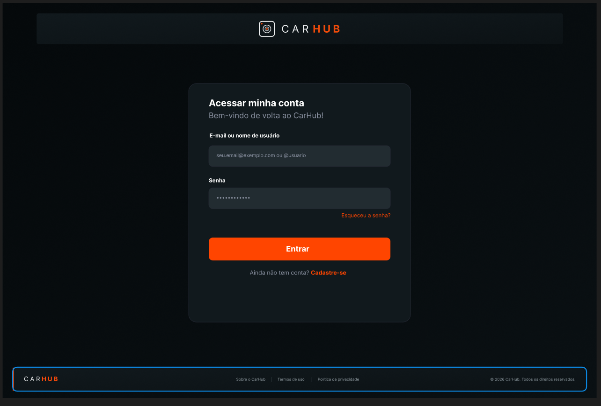

# CarHub

Projeto desenvolvido para a cadeira de **Programação e Modelagem para Web**. O CarHub é uma proposta de comunidade para entusiastas de carros, com compartilhamento de fotos, interação entre usuários e descoberta de encontros automotivos.

## Autores

- Gabriela Faraon
- Manoel Rodrigues
- Mariana Santos

## Tecnologias

HTML5, CSS3 e JavaScript puro, sem frameworks ou etapa de compilação.

## Como executar

Abra a pasta no VS Code e use **Open with Live Server** no `index.html`. Como os componentes HTML são carregados com `fetch`, é necessário um servidor HTTP local; abrir os arquivos diretamente por `file://` não funciona.

Se você tiver Python instalado, uma alternativa é executar na raiz:

```bash
python3 -m http.server 5500
```

Acesse [http://localhost:5500](http://localhost:5500).

## Funcionalidades atuais

- Página Principal com feed responsivo, ordem aleatória e carregamento progressivo em lotes.
- Catálogo local de 12 fotos, sem repetição na sessão. Ao esgotar as imagens, o feed mostra uma mensagem de término.
- Busca por título, autor, legenda e tags.
- Curtidas, comentários, favoritos e publicação com imagem, mantidos apenas durante a sessão da página.
- Sidebar e topbar fixas, com menu recolhível.
- Rodapé compartilhado com informações do projeto, termos e privacidade.
- Tela Tema com aparência escura, clara ou de acordo com o sistema. A preferência é salva no `localStorage` e aplicada a todas as telas.
- Tela Login com validação de e-mail/usuário e senha. Sem backend: ao validar, segue para a página Principal.
- Tela Perfil com capa, estatísticas, abas (Fotos, Meus eventos, Salvos) e grade de fotos de demonstração.

O projeto está em desenvolvimento. Encontros, criação completa de publicação e configurações aparecem no protótipo, mas suas telas ainda não foram implementadas. Não há backend, autenticação ou banco de dados. Dados de autores e interações do feed são fictícios. Avatares e fonte usam serviços externos e dependem de internet; as fotos dos posts estão no projeto.

## Publicações com mídia

A tela Nova publicação usa a identidade de demonstração da Gabriela (`@gbfaraon`) e permite selecionar ou arrastar até 10 fotos PNG/JPG e vídeos MP4, com até 25 MB por arquivo. É possível visualizar e remover anexos antes de publicar. As mídias são salvas localmente no IndexedDB e reaparecem em “Suas publicações” após recarregar a tela. A legenda e os demais dados continuam no `localStorage`.

Os arquivos ficam apenas neste navegador e dispositivo, sujeitos ao espaço disponível e à limpeza dos dados do site; não são enviados a um servidor.

## Chats

Painel flutuante fixo no canto inferior direito, disponível nas telas Principal, Encontros, Criar publicação e Perfil. Não aparece em Tema, Configurações ou Login. Permite buscar conversas, abrir uma conversa, enviar mensagens locais e minimizar ou fechar o painel. O histórico (até 100 mensagens por conversa) e a leitura das conversas são salvos neste navegador. Os contatos e mensagens recebidas são fictícios; não há comunicação entre usuários nem envio por servidor.

O componente segue a estrutura do projeto: `pages/containers/chats.html`, `styles/containers/chats.css` e `scripts/containers/chats.js`.

## Organização

```text
index.html                 # Entrada para a página Principal
pages/
  principal.html           # Feed
  tema.html                # Preferência de aparência
  login.html               # Acesso à conta
  perfil.html              # Perfil do usuário
  containers/              # HTML da sidebar e topbar
styles/
  main.css                 # Importações dos estilos compartilhados
  global.css               # Base visual e estilos compartilhados
  principal.css            # Estilos do feed
  tema.css                 # Estilos da tela Tema
  login.css                # Estilos da tela Login
  perfil.css               # Estilos da tela Perfil
  containers/              # CSS da sidebar e topbar
scripts/
  main.js                  # Carregamento dos arquivos e da tela atual
  global.js                # Funções compartilhadas e preferência de tema
  principal.js             # Comportamento do feed
  tema.js                  # Controles de aparência
  login.js                 # Validação do formulário de login
  perfil.js                # Estatísticas, abas e grade do perfil
  containers/              # JavaScript da sidebar e topbar
images/
  posts/                   # Fotografias do catálogo de demonstração
  figma/                   # Referências visuais do protótipo
```

Cada tela possui seu HTML, CSS e JavaScript. Os componentes compartilhados seguem a mesma separação dentro das pastas `containers`.

## Protótipo no Figma

[Ver o projeto CARHUB no Figma](https://www.figma.com/design/m7DuEU4P5v5mPEITvPsP3M/CARHUB?node-id=0-1).

As imagens abaixo são **referências do Figma**, não capturas da implementação atual. O rodapé está disponível como componente compartilhado nas telas, com links institucionais e direitos autorais. A tela Tema foi criada seguindo o estilo visual das referências.

### Principal


### Encontros — planejado


### Nova publicação — planejado


### Login

[](https://github.com/manoeldr/carhub/blob/main/images/figma/login.png)

### Perfil


### Configurações — planejado


## Recursos visuais

Fotos de demonstração: [Unsplash](https://unsplash.com/). Avatares de demonstração: [Pravatar](https://pravatar.cc/). Fonte Roboto: [Google Fonts](https://fonts.google.com/specimen/Roboto). Os títulos do catálogo descrevem as fotos conferidas visualmente, sem atribuir versões ou anos não confirmados.

## Repositório

[github.com/manoeldr/carhub](https://github.com/manoeldr/carhub)
